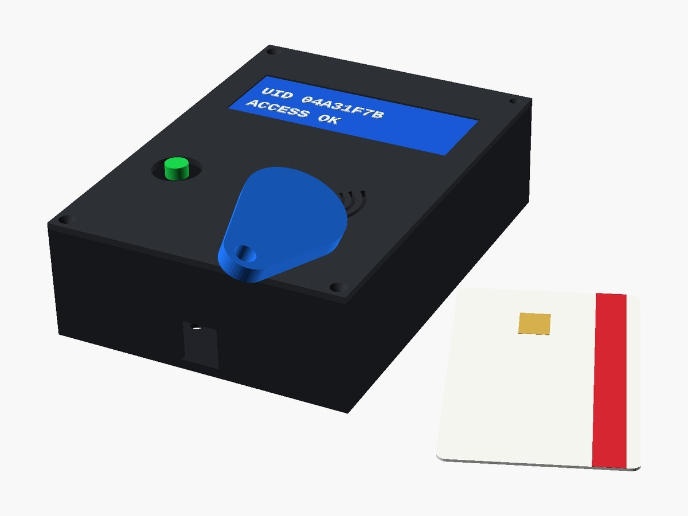

# Lettore di tag RFID con Arduino, display LCD e case stampato in 3D

> 📖 **Articolo completo con schema, foto e spiegazioni passo passo:**  
> **[Lettore di tag RFID con Arduino, display LCD e case stampato in 3D – www.emgi.it](https://www.emgi.it/2026/07/20/lettore-di-tag-rfid-con-arduino-display-lcd-e-case-stampato-in-3d/)**
>
> Altri progetti di elettronica, Arduino, ESP32, Home Assistant e stampa 3D su **[www.emgi.it](https://www.emgi.it)**

Un progetto semplice ma completo: un lettore di tag RFID a 13.56 MHz basato su Arduino che mostra l’UID delle tessere su un display LCD, racchiuso in un case progettato su misura e stampato in 3D. È la base perfetta per un controllo accessi, un antifurto fai-da-te o un sistema di timbratura.

**Modulo RC522 (bus SPI)** — attenzione: il modulo funziona a **3.3V**. Collegarlo a 5V lo danneggia.

## Cosa serve

| Componente | Note |
|---|---|
| Arduino UNO o Nano | Qualsiasi scheda ATmega328P |
| Modulo RFID RC522 | Lettore 13.56 MHz, protocollo MIFARE, interfaccia SPI |
| Display LCD 16×2 con modulo I2C | Backpack PCF8574, indirizzo tipico 0x27 (o 0x3F) |
| Tag/tessere MIFARE | Card, portachiavi o adesivi da 13.56 MHz |
| Cavetti dupont | Femmina-femmina o maschio-femmina a seconda delle schede |
| Case stampato in 3D | File STL scaricabile in fondo all’articolo |

## Librerie necessarie

Dal Library Manager dell’IDE Arduino installare:

- **MFRC522** (di Miguel Balboa)
- **LiquidCrystal_I2C** (di Frank de Brabander)

## Collegamenti elettrici

Scheda: **Arduino UNO/Nano**. Pin verificati sullo sketch (`SS_PIN 10`, `RST_PIN 9`, LCD I2C `0x27` 16×2).

### Modulo RFID RC522 (SPI) — ⚠️ alimentazione a 3,3 V

| RC522 | Arduino |
|---|---|
| SDA (SS) | D10 |
| SCK | D13 |
| MOSI | D11 |
| MISO | D12 |
| IRQ | non collegato |
| RST | D9 |
| 3.3V | **3.3V** |
| GND | GND |

### Display LCD I2C (5 V)

| LCD I2C | Arduino |
|---|---|
| VCC | 5V |
| GND | GND |
| SDA | A4 |
| SCL | A5 |

- **Non alimentare l'RC522 a 5 V**: si danneggia. Le linee SPI a 5 V di UNO/Nano in pratica funzionano, ma per un montaggio definitivo è consigliato un adattatore di livello.
- Se l'LCD resta vuoto, regola il trimmer del contrasto sul retro del modulo I2C o prova l'indirizzo `0x3F`.
- Su Arduino **Mega** i pin SPI sono diversi: SCK 52, MOSI 51, MISO 50.

## Contenuto del repository

| Percorso | Descrizione |
|---|---|
| `Lettore_Tag/Lettore_Tag.ino` | Sketch Arduino |
| `case_3d/lettore_tag.stl` | Modello 3D da stampare |
| `immagini/` | Foto e immagini dell'articolo |

## Come si usa

1. Installa le librerie **MFRC522** (Miguel Balboa) e **LiquidCrystal_I2C** (Frank de Brabander).
2. Apri [`Lettore_Tag/Lettore_Tag.ino`](Lettore_Tag/Lettore_Tag.ino) e carica su Arduino.
3. ⚠️ Il modulo RC522 va alimentato a **3,3 V**: a 5 V si danneggia.

Schema dei collegamenti, dettagli e risoluzione dei problemi: **[articolo su www.emgi.it](https://www.emgi.it/2026/07/20/lettore-di-tag-rfid-con-arduino-display-lcd-e-case-stampato-in-3d/)**.

## Immagini

## Licenza

- Codice e configurazioni: [MIT](LICENSE)
- Modelli 3D, schemi e immagini: [CC BY-SA 4.0](https://creativecommons.org/licenses/by-sa/4.0/deed.it)

---

**Autore:** Massimiliano Sandrin – **[eMGi.it](https://www.emgi.it)** · Domande e commenti sotto l'[articolo sul sito](https://www.emgi.it/2026/07/20/lettore-di-tag-rfid-con-arduino-display-lcd-e-case-stampato-in-3d/).
