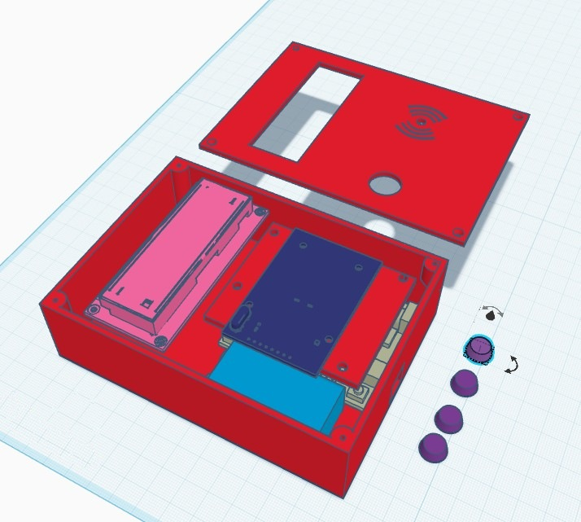

# RFID tag reader with Arduino, LCD and 3D-printed case

> 📖 **Full article with wiring diagram, photos and step-by-step explanations (in Italian):**  
> **[RFID tag reader with Arduino, LCD and 3D-printed case – www.emgi.it](https://www.emgi.it/2026/07/20/lettore-di-tag-rfid-con-arduino-display-lcd-e-case-stampato-in-3d/)**
>
> More electronics, Arduino, ESP32, Home Assistant and 3D printing projects at **[www.emgi.it](https://www.emgi.it)**

A simple but complete project: a 13.56 MHz RFID tag reader based on Arduino that shows the card UID on an LCD, housed in a custom 3D-printed case. It is the perfect starting point for access control, a DIY alarm system or a time-clock system.

**RC522 module (SPI bus)** — warning: the module runs at **3.3 V**. Connecting it to 5 V damages it.

## What you need

| Component | Notes |
|---|---|
| Arduino UNO or Nano | Any ATmega328P board |
| RC522 RFID module | 13.56 MHz reader, MIFARE protocol, SPI interface |
| 16×2 LCD with I2C module | PCF8574 backpack, usual address 0x27 (or 0x3F) |
| MIFARE tags/cards | 13.56 MHz cards, key fobs or stickers |
| Dupont jumper wires | Female-female or male-female depending on the boards |
| 3D-printed case | STL file in [`case_3d`](case_3d) |

## Required libraries

Install from the Arduino IDE Library Manager:

- **MFRC522** (by Miguel Balboa)
- **LiquidCrystal_I2C** (by Frank de Brabander)

## Wiring

Board: **Arduino UNO/Nano**. Pins checked against the sketch (`SS_PIN 10`, `RST_PIN 9`, I2C LCD `0x27` 16×2).

### RC522 RFID module (SPI) — ⚠️ 3.3 V power

| RC522 | Arduino |
|---|---|
| SDA (SS) | D10 |
| SCK | D13 |
| MOSI | D11 |
| MISO | D12 |
| IRQ | not connected |
| RST | D9 |
| 3.3V | **3.3V** |
| GND | GND |

### I2C LCD (5 V)

| I2C LCD | Arduino |
|---|---|
| VCC | 5V |
| GND | GND |
| SDA | A4 |
| SCL | A5 |

- **Do not power the RC522 from 5 V**: it gets damaged. The 5 V SPI lines of the UNO/Nano work in practice, but a level shifter is recommended for a permanent build.
- If the LCD stays blank, adjust the contrast trimmer on the back of the I2C module or try address `0x3F`.
- On an Arduino **Mega** the SPI pins are different: SCK 52, MOSI 51, MISO 50.

## Repository contents

| Path | Description |
|---|---|
| `RFID_Tag_Reader/RFID_Tag_Reader.ino` | Arduino sketch |
| `case_3d/rfid_reader_case.stl` | 3D model to print |
| `images/` | Photos and images |

## How to use it

1. Install the **MFRC522** (Miguel Balboa) and **LiquidCrystal_I2C** (Frank de Brabander) libraries.
2. Open [`RFID_Tag_Reader/RFID_Tag_Reader.ino`](RFID_Tag_Reader/RFID_Tag_Reader.ino) and upload it to the Arduino.
3. ⚠️ The RC522 module must be powered from **3.3 V**: 5 V damages it.

Wiring diagram, details and troubleshooting: **[article on www.emgi.it](https://www.emgi.it/2026/07/20/lettore-di-tag-rfid-con-arduino-display-lcd-e-case-stampato-in-3d/)** (in Italian).

## Images

## License

- Code and configuration: [MIT](LICENSE)
- 3D models, diagrams and images: [CC BY-SA 4.0](https://creativecommons.org/licenses/by-sa/4.0/)

---

**Author:** Massimiliano Sandrin – **[eMGi.it](https://www.emgi.it)** · Questions and comments below the [article on the website](https://www.emgi.it/2026/07/20/lettore-di-tag-rfid-con-arduino-display-lcd-e-case-stampato-in-3d/).
